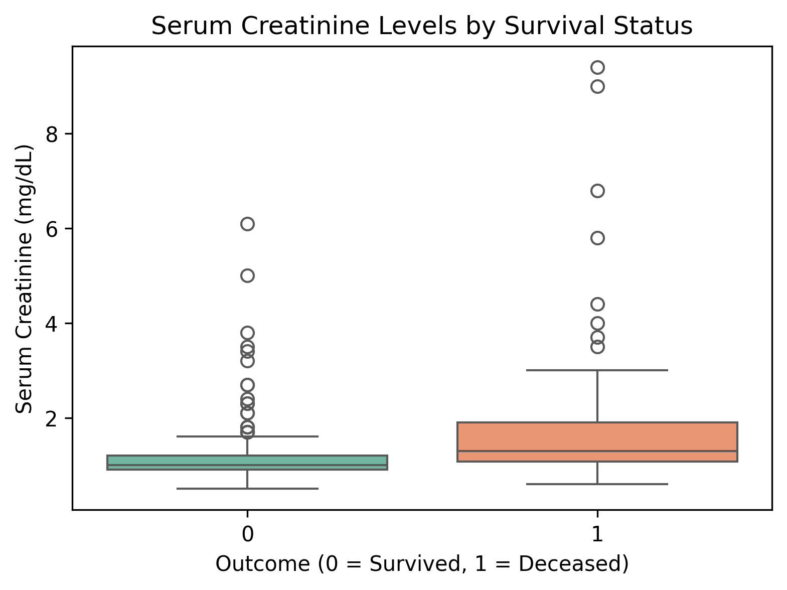
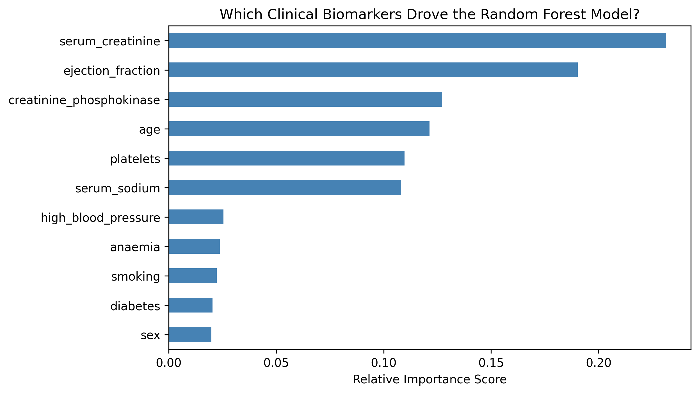

# Heart Failure Biomarker Analysis & Mortality Risk Prediction

## 1. Clinical Question
Which baseline clinical biomarkers best separate high-risk heart failure patients from survivors at hospital admission, and how accurately can machine learning models predict mortality risk using only initial clinical measurements?

## 2. Dataset & Methodology
- **Dataset:** [UCI Heart Failure Clinical Records](https://uci.edu) (N = 299 patients, 13 clinical features, 0 missing values), originally published by [Chicco & Jurman (2020)](https://biomedcentral.com).
- **Exploratory Analysis:** Compared group medians alongside means to account for extreme clinical outliers (such as creatinine phosphokinase spikes).
- **Statistical Testing:** Applied non-parametric Mann-Whitney U tests (`scipy.stats`) to evaluate whether biomarker differences between survivors (`0`) and non-survivors (`1`) were statistically significant (`p < 0.05`).
- **Machine Learning & Data Leakage Prevention:** Excluded the `time` (follow-up duration) column prior to training so models rely strictly on admission vitals rather than post-admission outcomes. Split data 80/20 (stratified) and compared **Logistic Regression** and **Random Forest** classifiers using ROC-AUC and Recall.

## 3. Key Findings & Visualizations
- **Top Clinical Biomarkers:** Lower left-ventricular `ejection_fraction` (median 30% vs. 38%, `p < 0.0001`) and elevated `serum_creatinine` (median 1.3 vs. 1.0 mg/dL, `p < 0.0001`) strongly separated non-survivors from survivors.
- **Model Performance:** On the held-out test set, Logistic Regression achieved a ROC-AUC of **0.745** and Random Forest achieved **0.795**, confirming that baseline kidney and cardiac function markers carry strong predictive signal.

## 4. Limitations & Next Steps
- **Sample Size & Cohort:** The dataset includes 299 patients from a single clinical cohort, which limits generalizability across broader demographics.
- **Class Imbalance:** Because ~68% of patients survived, standard models under-predict the minority high-risk class (`Recall`). Next steps include testing class-weighted loss functions, threshold tuning to prioritize clinical sensitivity, and 5-fold cross-validation.
